# TravelMemory MERN Deployment with Terraform and Ansible

## Assignment objective
Deploy the TravelMemory MERN application on AWS. Terraform provisions the VPC, public/private subnets, Internet Gateway, NAT Gateway, routes, EC2 instances, IAM role, security groups, outputs, and basic CloudWatch monitoring. Ansible installs and secures MongoDB, configures Node.js and Nginx, builds React, and runs Express as a systemd service.

## Architecture
- Public subnet: Ubuntu web EC2 with SSH limited to the administrator `/32`; Nginx and React on TCP 3000; Express on localhost TCP 3001.
- Private subnet: Ubuntu MongoDB EC2 without a public IP; outbound package access through the required NAT Gateway.
- MongoDB TCP 27017 and database SSH are permitted only from the web security group.
- Application flow: browser -> Nginx/React -> Express routes `/trip`, `/uploads`, `/health` -> MongoDB private IP.
- Monitoring: CloudWatch alarms for both EC2 status checks and web CPU above 80%.

## Repository layout
```text
backend/                TravelMemory Express application
frontend/               TravelMemory React application
terraform/              AWS infrastructure
ansible/                Configuration and application deployment
screenshots/             Evidence paths used below
IMPLEMENTATION_REPORT.md Detailed assignment report
SUBMISSION_LINK.txt      File to submit through Vlearn
```

## Prerequisites
AWS account, AWS CLI, Terraform 1.6+, Ansible, Git, an EC2 key pair in `ap-south-1`, and the matching local PEM file.

## 1. AWS authentication
```bash
aws configure
aws sts get-caller-identity
```

### AWS CLI identity
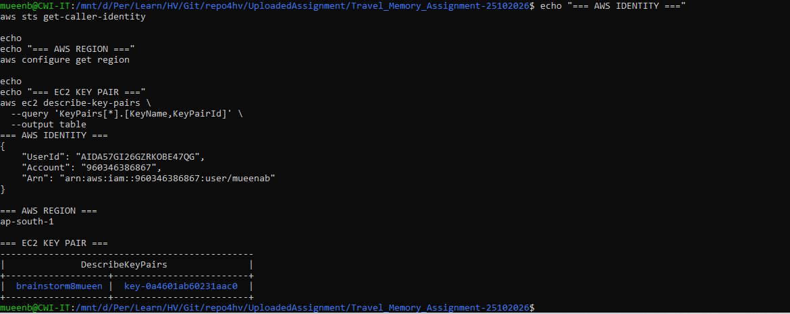

## 2. Terraform initialization and validation
```bash
cd terraform
cp terraform.tfvars.example terraform.tfvars
# Set key_name and admin_cidr in terraform.tfvars
terraform fmt -recursive
terraform init
terraform validate
```

### Terraform initialized and validated
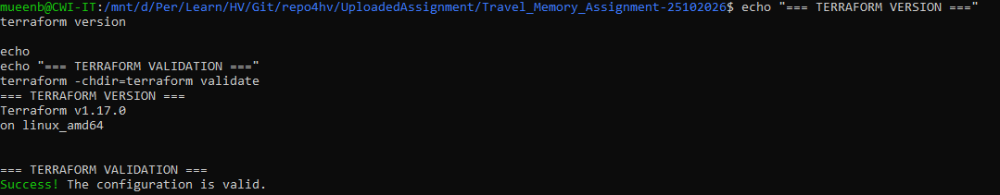

## 3. Terraform plan and apply
```bash
terraform plan -out=tfplan
terraform apply tfplan
terraform output
```

### Terraform plan
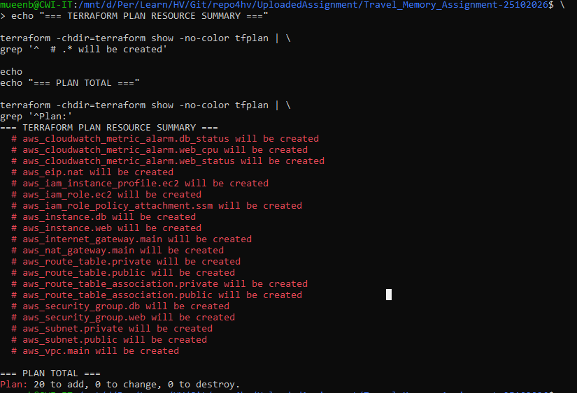

### Terraform apply
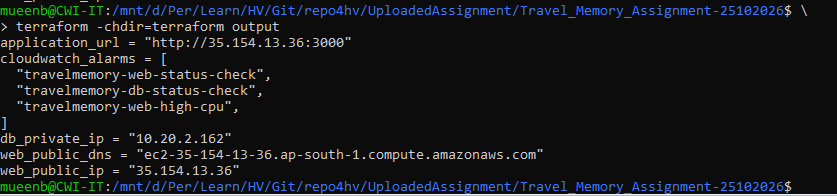

### VPC, public subnet, and private subnet
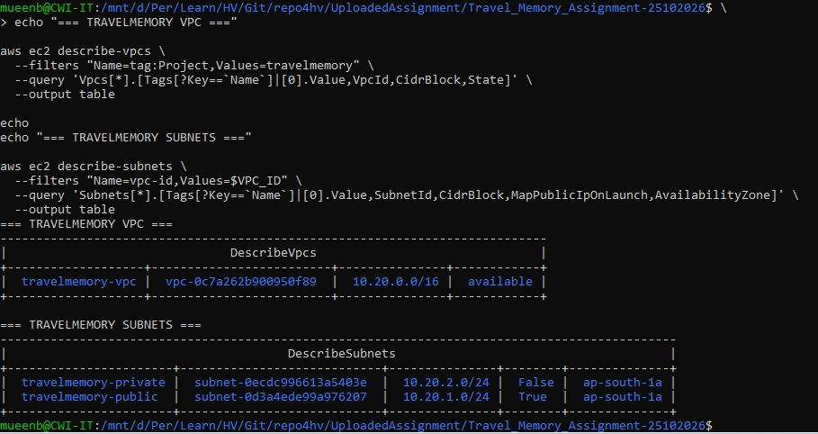

### EC2 web and database instances
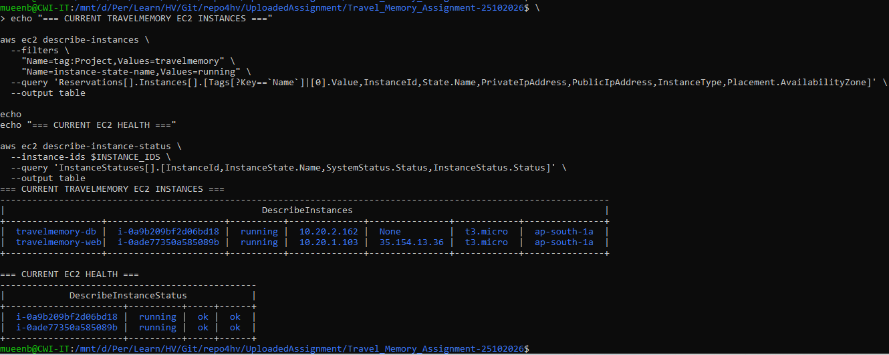

### Security groups and restricted rules
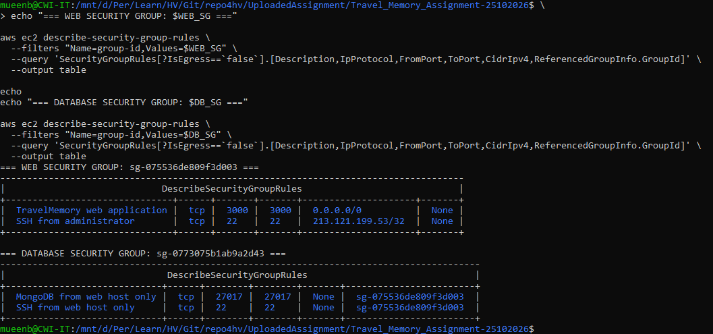

### CloudWatch alarms
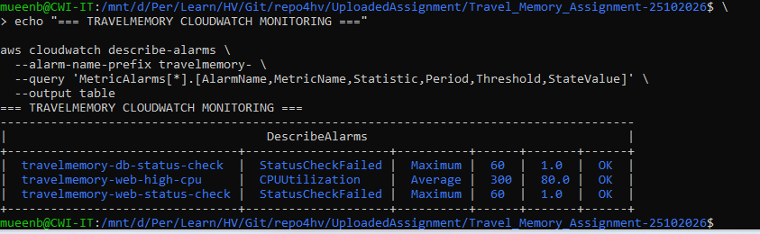

## 4. Ansible configuration and deployment
```bash
cd ../ansible
ansible-galaxy collection install -r requirements.yml
cp inventory.ini.example inventory.ini
cp group_vars/all.yml.example group_vars/all.yml
# Replace all placeholders using terraform output values and your local PEM path.
ansible all -m ping
ansible-playbook --syntax-check site.yml
ansible-playbook site.yml
```

### Ansible connectivity
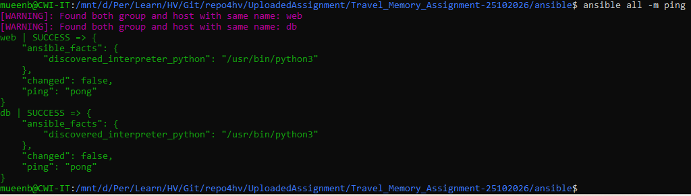

### Ansible deployment completed
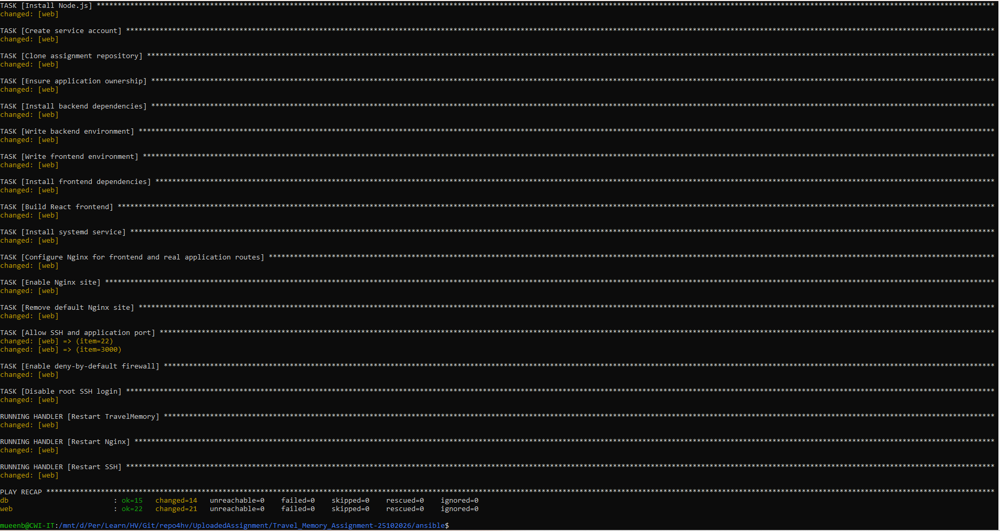

## 5. Service and application validation
```bash
curl http://WEB_PUBLIC_IP:3000/health
ssh -i ~/.ssh/YOUR_KEY.pem ubuntu@WEB_PUBLIC_IP 'sudo systemctl --no-pager status travelmemory nginx'
ssh -J ubuntu@WEB_PUBLIC_IP -i ~/.ssh/YOUR_KEY.pem ubuntu@DB_PRIVATE_IP 'sudo systemctl --no-pager status mongod'
```
Browse to the `application_url` Terraform output. Create a travel record, refresh the page, and confirm that the record remains available.

### MongoDB service on private instance
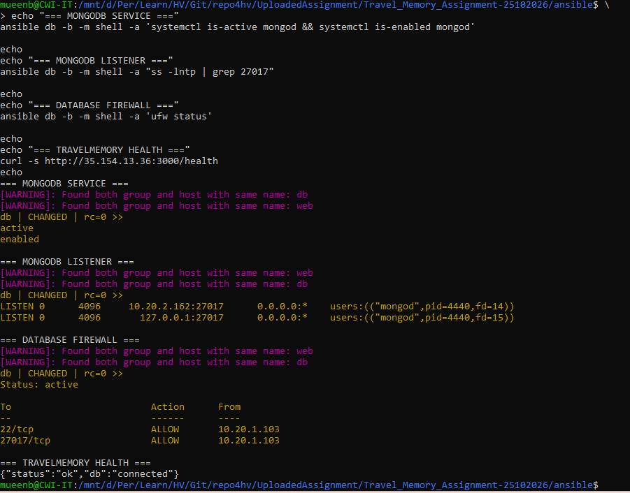

### TravelMemory home page
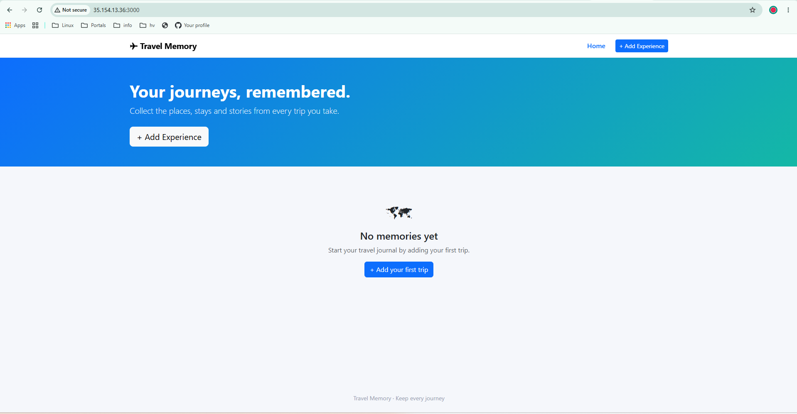

### Create a travel record
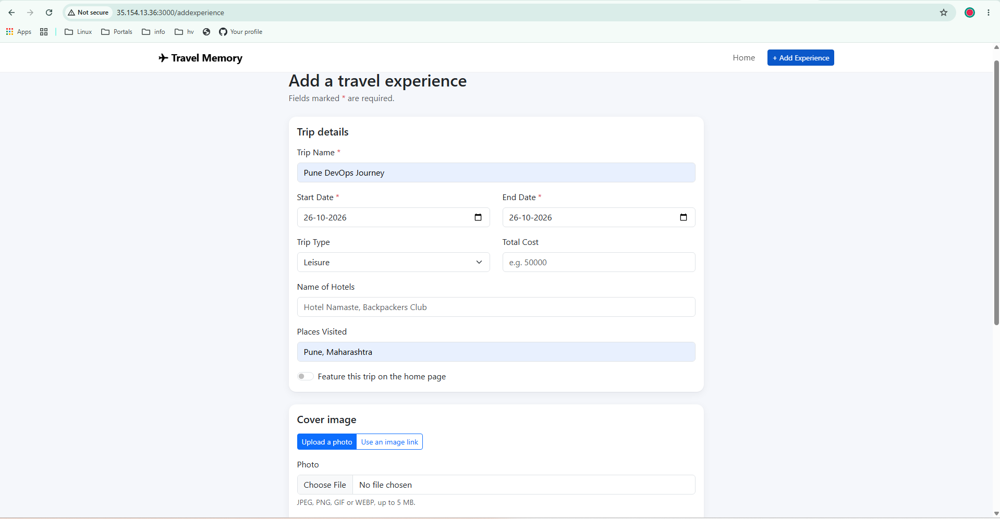

### Persisted travel record
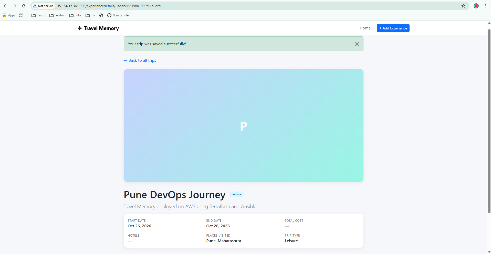

## Security controls
- Database has no public IP.
- SSH to public EC2 is restricted to `admin_cidr`.
- Database SSH and MongoDB are restricted by security-group source reference.
- Encrypted gp3 roots and IMDSv2 are required.
- MongoDB authentication, UFW deny-by-default, disabled root SSH, a non-login service user, and Git exclusions protect secrets and hosts.

## Cleanup
```bash
cd terraform
terraform destroy
```

### Terraform destroy completed
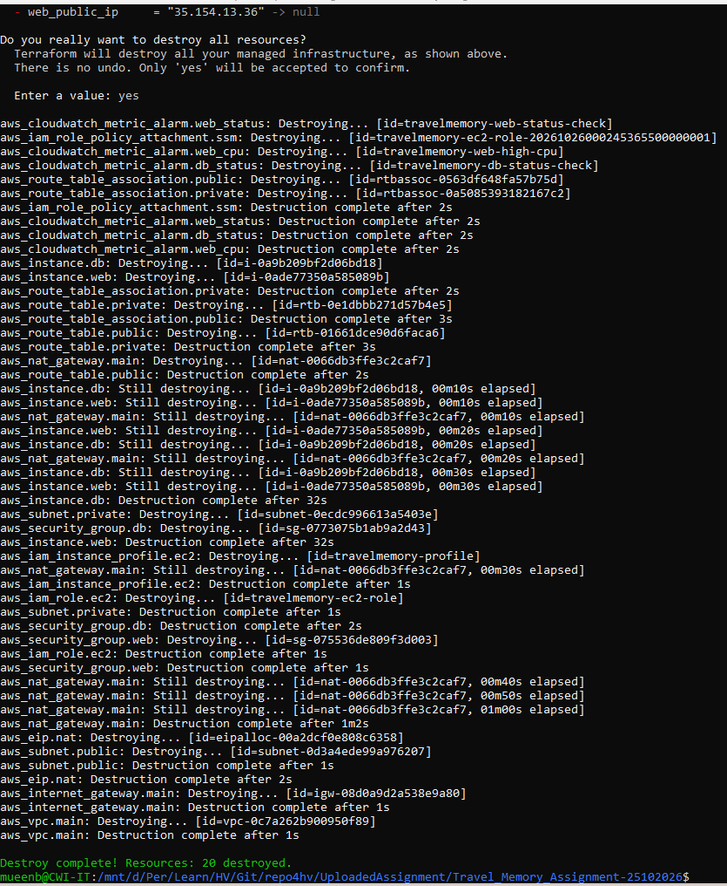

## Source application
Original source: https://github.com/UnpredictablePrashant/TravelMemory
